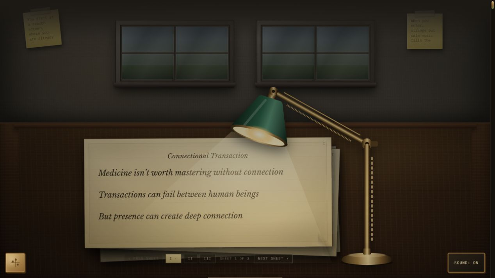
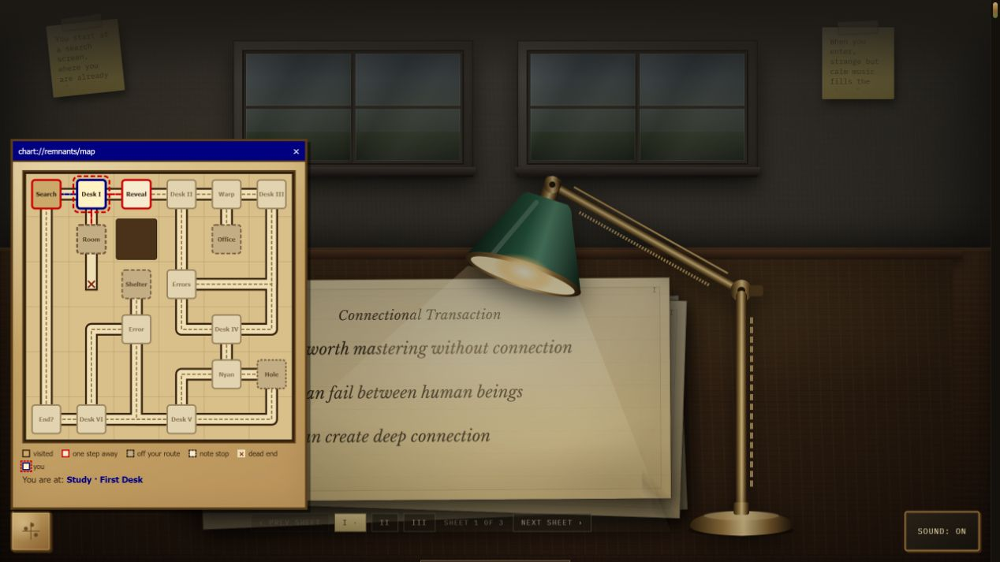

# Remnants of a New World

A poetry portfolio you explore like a game. Follow a search result into a dim room, flip through poems under a desk lamp, and pick a door. You might peel apart a portrait, steer a rainbow cat past meteors, or try to save a line before a black hole takes it.

The rooms mix found poems, Markov poetry, and weaving. Each route leaves a few pieces behind. Open the map when you get lost, or try **I'm Feeling Lucky** to start somewhere in the middle.

**[Enter the maze](https://zeidal-ruzouq.github.io/Remnants-of-a-New-World/)**

## Where things are

| Path | What’s inside |
| --- | --- |
| [index.html](index.html) | The search screen and the order the scripts load. |
| [js/content/](js/content/) | Poems, wall notes, room order, reflection, and references. |
| [js/game/](js/game/) | The maze map, levels, routes, and achievements. |
| [js/world/](js/world/) | The rooms, lamp, weather, sound, and poem collages. |
| [css/](css/) and [assets/](assets/) | The look of each scene, collage images, and music. |

Run `python -m http.server 8765` from the repo root and open [localhost:8765](http://127.0.0.1:8765). [Project guide and editing notes](docs/guide.md)

## Screenshots

| Reading room | Maze map |
| --- | --- |
|  |  |

The full reflection, process statement, and credits appear at the end of the journey.
